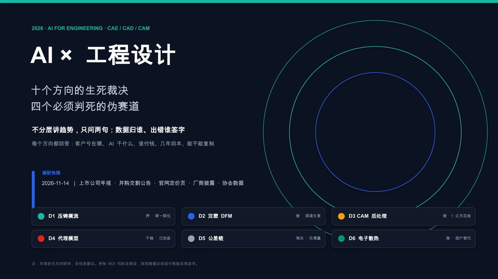

# AI × 工程设计：CAE / CAD / CAM 十个方向的生死裁决

28 页方向研判报告。不分层讲趋势，只按两层切：**训练数据归谁、出错谁签字**。十个方向里推荐 4 个、判死 4 个，并给出每个方向的单客户 ROI、预算科目、毛利结构与下注止损线。

核心结论：这个赛道在中国唯一的结构性优势是「离工艺近」，不是「AI 强」。谁把产品做进压铸厂、模具厂、机床厂的车间，谁就赢；谁把产品做成「更快的 Ansys」，谁就死。

**调研快照**：2026-11-14（CST）
**数据口径**：上市公司年报与券商研报、并购交割公告、官网定价页、厂商公开案例、行业协会数据
**测算口径**：所有 ROI 均为「假设 + 公式」结构，假设逐条列出，现场可用客户真实数据替换

## 文件

| 格式 | 页数 | 文件 |
|---|---:|---|
| 可编辑 PPTX | 28 | [AI与工程设计十大创业方向.pptx](AI与工程设计十大创业方向.pptx) |
| 分享 PDF | 28 | [AI与工程设计十大创业方向.pdf](AI与工程设计十大创业方向.pdf) |
| 调研与测算笔记 | — | [research-notes.md](research-notes.md) |

## 结构

| 页码 | 内容 |
|---|---|
| 1 | 封面 |
| 2 | 执行摘要：三个反共识判断 |
| 3 | 口径雷区：中国 CAE 市场三个数差 3.4 倍 + 中望 CAE 0.12 亿 |
| 4 | 天花板实证：索辰 4.66 亿 / 净利率 6.8% |
| 5 | 四个筛子：数据、签字、科目、巨头（顺序不能换） |
| 6 | 十方向全景矩阵 |
| 7–9 | D1 压铸模流：工艺与客户 / ROI 推演 / 风险与下注 |
| 10–11 | D2 注塑模流 + DFM 报价：为什么试模费不值钱 / 商业模型与裁决 |
| 12–13 | D3 CAM 刀路 + 后处理：CloudNC 定价与责任边界 / TAM 1 亿的算术 |
| 14–16 | D4 代理模型 ROM：全球热钱 / 已是巨头功能 / 18 个月封盘时间线 |
| 17 | D5 拓扑优化：按服务公司估值，不按 SaaS |
| 18 | D6 电子散热 / 液冷：被低估的国产替代窗口 |
| 19 | 四个必须判死的方向 |
| 20 | 推荐顺序与四档下注方式（含止损线） |
| 21–22 | 六个拷问逐个自答 |
| 23 | 最致命的一条：中国工程师便宜 3 倍 |
| 24 | 开源核（OpenFOAM / CalculiX / FreeCAD）能不能当基座 |
| 25 | 卖工具 / 卖服务 / 卖结果：顺序不能反 |
| 26 | 数据来源、证据分级与四条不确定性 |
| 27 | 30 天证伪计划 |
| 28 | 最终裁决：进车间，不进机房 |

## 方向裁决一览

| 方向 | 可验证性 | 付费意愿 | 落地难度 | 裁决 |
|---|---:|---:|---:|---|
| D1 压铸 / 铸造模流 + 工艺智能体 | 3 | 3 | 2 | 🥇 首选重仓 |
| D6 电子散热 / 液冷热仿真 | 2 | 3 | 2 | 🥈 次选（团队需有求解器底子） |
| D2 注塑模流 + DFM / 报价 | 2 | 2 | 1 | 做，按渠道小生意 |
| D3 CAM 刀路 + 后处理 | 3 | 2 | 2 | 做，1 亿天花板 |
| D5 拓扑优化 / 生成式设计 | 3 | 2 | 1 | 做，按工程服务估值 |
| D4 仿真代理模型 ROM | 3 | 3 | 1 | 不做（品类已封盘） |
| AI 加速通用求解器 | 2 | 2 | 1 | 创业者不碰 |
| 图纸转 3D | 1 | 1 | 2 | 不做（无付费方） |
| 装配公差链 | 2 | 1 | 3 | 淘汰（AI 无增量） |
| 通用几何大模型 | 1 | 1 | 1 | 明确放弃 |

## 支撑结论的关键数字

- **0.12 亿元**：中望软件 2025 年 CAE 收入。中国最大国产 CAD 厂商、几十万家客户、做了十几年 CAE 的成绩——这就是软件科目的真实天花板。
- **60.5 / 152.4 / 205 亿元**：2025 年中国 CAE 的三个口径，彼此差 3.4 倍。62% 的 BP 用最宽口径，客户掏钱的科目是最窄口径。
- **4.66 亿 / 6.8%**：索辰 2025 年营收与净利率。国产 CAE 龙头，军工全覆盖，做了二十年。
- **1,200 元 vs 3,400–4,300 元**：中国与欧美 CAE 工程师的全成本/人天。这 3 倍的差，直接杀死「省人天」的商业故事。
- **106 亿美元 / 310 亿美元 / 27 亿欧元**：Siemens-Altair、Synopsys-Ansys、Cadence-Hexagon 三笔交易（交割分别在 2025/03、2025/07、2026/02）。
- **15,000 家**：适创科技智铸超云的付费用户数；2026 年 7 月完成近亿元 B++ 轮。
- **1,076 元/套**：某高校单一来源采购 DTAS 46 套的折算单价——公差链工具的真实价格锚。

## 交叉验证要点

- **口径差**：60.5 亿（IDC）与 205 亿（含服务/超算）不可混用；报告第 3 页与第 26 页均标注了这一点。
- **中望 CAE 口径**：0.12 亿元是「CAE 产品收入」，不含定制开发；与广义口径对比时会显得更小，引用时须说明。
- **并购时间**：Cadence 收购 Hexagon D&E 为 2025/9 签约、**2026-02-23 交割**；论证「窗口关闭」应引用交割时点。
- **D1 ROI**：良率 60%→70% 是全篇最承重的假设，最敏感变量；若只能做到 +5pct，定价须压到 100 万以下。
- **人天系数**：1.35（社保）× 13（薪）为本报告推算，若实际为 0.9 × 12，人天成本降至 930 元。
- **D4 全球案例**：Neural Concept 的「50+ 企业客户、收入 18 个月增 4 倍」为企业自述，未经审计。
- **适创 900 万/年**：来自厂商公开案例（极氪、长安、奇瑞），属 B 级证据，非第三方审计。
