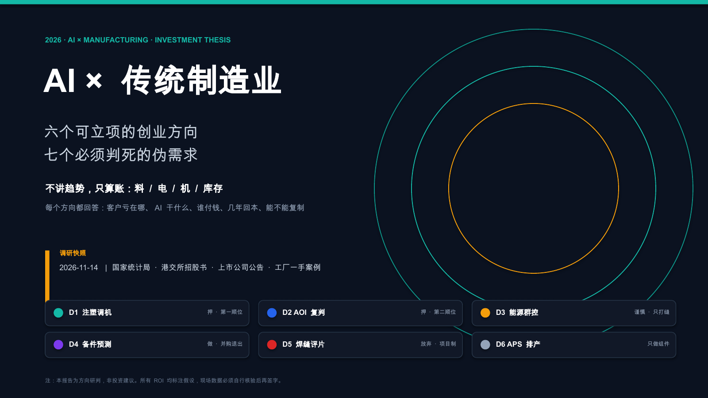

# AI × 传统制造业：六个可立项的创业方向

28 页方向研判报告。不做趋势综述，只回答五个问题：客户亏在哪、AI 具体干什么、谁付钱、几年回本、能不能复制。结论是两押四弃——只推荐 D1（注塑换模调机）与 D2（AOI 误报复判），并明确判死七个伪需求。

**调研快照**：2026-11-14（CST）
**数据口径**：国家统计局规上工业企业效益月报、工信部数字化转型指标、港交所招股书与年报、工厂一手案例
**测算口径**：所有 ROI 均为「假设 + 公式」结构，假设逐条列出，现场可用客户真实数据替换

## 文件

| 格式 | 页数 | 文件 |
|---|---:|---|
| 可编辑 PPTX | 28 | [AI与传统制造业六大创业方向.pptx](AI与传统制造业六大创业方向.pptx) |
| 分享 PDF | 28 | [AI与传统制造业六大创业方向.pdf](AI与传统制造业六大创业方向.pdf) |
| 调研与测算笔记 | — | [research-notes.md](research-notes.md) |

## 结构

| 页码 | 内容 |
|---|---|
| 1 | 封面 |
| 2 | 执行摘要：三个反共识判断 |
| 3 | 第一个约束：客户的资产负债表（亏损面 29.95%） |
| 4 | 定价前提 01：只有四本账能算 |
| 5 | 定价前提 02：数据只有三档 + TAM 校正 |
| 6 | 定价前提 03：毛利算术与账期 |
| 7 | 全景：六方向评分矩阵 |
| 8–10 | D1 注塑换模调机：工艺 / ROI / 敏感性与护城河 |
| 11–13 | D2 AOI 误报复判：工艺 / 单位经济 / 原厂威胁与切口 |
| 14–15 | D3 能源群控：为什么证据最硬 / 为什么没位置 |
| 16–17 | D4 售后备件：单位经济 / 天花板与并购退出 |
| 18 | D5 焊缝 DR 评片：判死理由 |
| 19 | D6 APS 排产：为什么只做组件 |
| 20 | 排序：可验证性 × 付费意愿 × 落地难度 |
| 21 | 淘汰名单：七个必须判死的方向 |
| 22 | 六个拷问逐个自答 |
| 23 | 大厂威胁排序（设备原厂 > 集成商 > 华为） |
| 24 | 尽调七问 |
| 25 | 三个死法 |
| 26 | 数据来源、证据分级与四条不确定性 |
| 27 | 下一步：30 天证伪计划 |
| 28 | 最终裁决 |

## 核心数据

| 方向 | 单厂经济 | 毛利 | 回本 | 判决 |
|---|---:|---:|---:|---|
| D1 注塑换模调机 | 72 万/年（40 台机） | 62–70% | 11 个月 | 🥇 第一顺位 |
| D2 AOI 误报复判 | 40–70 万/年（10 条线） | 72–80% | 20–36 个月（按张计费可到 4–9 个月） | 🥈 第二顺位 |
| D3 空压/制冷群控 | 43.2 万/年（电费 3,000 万厂） | 45–55% | 1.4 年 | 🥉 只打缝 |
| D4 售后备件预测 | 80 万/年（库存 8,000 万） | 68–75% | 1.5 年 | 第四，并购退出 |
| D5 焊缝 DR 评片 | 账面 65 万/年，实际≈0 | 38–48% | >4.6 年 | 放弃 |
| D6 APS 排产 | 理论 630 万/年，兑现约 30% | 45–55% | 1–3 年 | 只做组件 |

## 支撑结论的关键数字

- **29.95%**：2026 年 7 月规上工业企业亏损面，15.34 万家亏损、累计亏损 1.16 万亿，2011 年以来同期最高。
- **35.0%**：创新奇智 2025 年毛利率——硬件+实施混合交付的毛利天花板；思谋三年累亏 10.45 亿、估值 12.3 亿美元。
- **67.9 天 / 25.2%**：规上工业应收账款回收期与逾期占比；工业软件项目做 1,000 万营收要垫 600–750 万。
- **70 → 30 min**：长虹爱创注塑车间换模调机时长，废品率 2.91% → 2.26%（官方口径废品损耗 -22%、调机时长 -37%）。
- **5–15% → <1%**：规则式 AOI 误报率与 AI 介入后的水平，USI 环旭电子实测改善 90%。
- **6,000+ 家 / 26 万台**：蘑菇物联的客户与在线设备规模，累计节电 36 亿度。
- **800 亿 / 近 500 亿**：工程机械行业配件库存与其中无效库存。

## 交叉验证要点

- **亏损面口径**：29.95% 是「规上工业企业」，不是「制造业」。2025 年制造业亏损面为 23.43%，两者不可并列——报告第 3 页与第 26 页均标注了这一点。
- **长虹样本代表性**：70 → 30 分钟来自日均换模近 60 次、月倒换 1,700 副次的满负荷大厂，属极端值。用于中型厂 ROI 时必须降档，这也是把「日均换模次数」列为 D1 第一敏感变量的原因。
- **D2 的 ROI 陷阱**：按「省人」测算得到 29.6 万/年，但客户不会裁人；可兑现区间应取 40–70 万，并按复判张数计费以降低销售阻力。
- **D5 的成功案例结构**：宝世顺为华为共建、国家管网为自研——三个案例里两个不是第三方采购，恰好说明钱流向集成商与自研。
- **APS 数据可信度**：准时交付率 60–75%、工时差异 >15% 均来自厂商口径白皮书，存在夸大动机，已标为 C 级证据。
- **信通院数字**：76% 启动 AI / <15% 有量化收益为二手转引，未见原始报告，标为 C 级。
