# AI 时代，什么被折叠，什么不能

**计算机基础栈 vs 个人的本质栈**

这两年最容易被误读的一件事，是「门槛变低了」。

门槛确实低了：环境不用手工配，Dockerfile 三分钟能出一份，报错贴进去就有解释，听不懂的概念随时能问。但降下来的是入场券的价格，不是考试的难度。同一门手艺，两个人用同一个模型，一个人拿到能上线的东西，另一个人拿到一份正确的废话——差距不在工具，在提问的人带着什么样的栈来。

这场分享把两件事放在一张图上：一张是计算机技术的基础栈，从机房到模型运行时，五层；另一张是个人的本质栈，从金字塔到 BSC，四个思维模型。前者决定你能审多深的 AI 输出，后者决定你能向 AI 提出多好的问题。前者是公共栈，任何人都能下载；后者是私有栈，唯一不可转让。

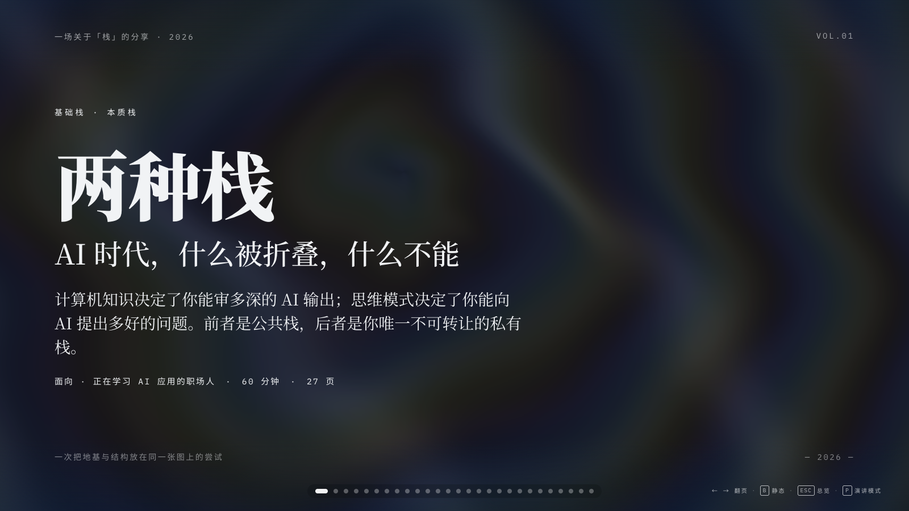

## 01 · 一份可带走的清单

今天不聊工具，聊结构。工具三个月换一轮，结构十年不用改。

离开这一小时，你手里应该多一张纸：**05 层地基、04 个模型、01 条链、03 个动作**。

整场内容都指向一句判断：AI 把「怎么做」的价格打到了接近零，把「做什么」和「做到什么程度算对」的价格抬到了最高。

## 02 · 入场券便宜了，考试没变

把两代人的学习路径并排放，差别非常直观。

过去：学语言、学操作系统、学网络，折腾环境、配依赖、踩编译错误，两年后才敢接第一个真实项目。能力长在「亲手做过」上。

现在：六周内就能做出可用的东西，卡住的地方才回头补那一层，AI 负责写、你负责验收。能力长在「判断过」上。

路径变短，不等于判断力自动变强。**变短的只是入门，变难的是分辨。**

## 03 · 第一个问题：你凭什么判断

所以第一个问题不是「怎么用 AI」，而是——

当 AI 写得比你快，你凭什么判断它写对了？

这个问题里没有一行代码。它问的是：你的栈有多厚。没有栈的人，只能凭「看起来挺对」验收；有栈的人，能指着某一行说，这里在我的机器上会 OOM。

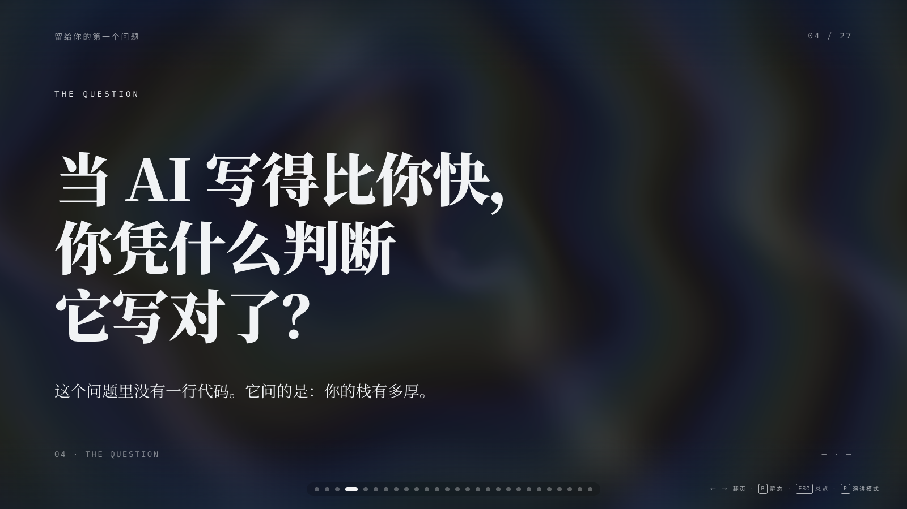

## 04 · 第一幕：基础栈

先看地基。

五层从机房到模型，AI 没有替你拆掉，只是替你搬了砖。砖搬得快了，图纸还得你自己看。

## 05 · 五层地基

从物理到语义，五层依次是：机房与硬件、内核与网络、运行时与容器、数据与协议、模型运行时。

缺一层，就会在某个深夜来电里露馅。而露馅的方式往往很朴素：不是你不懂原理，是你不知道这一层的哪个参数在这台机器上是多少。

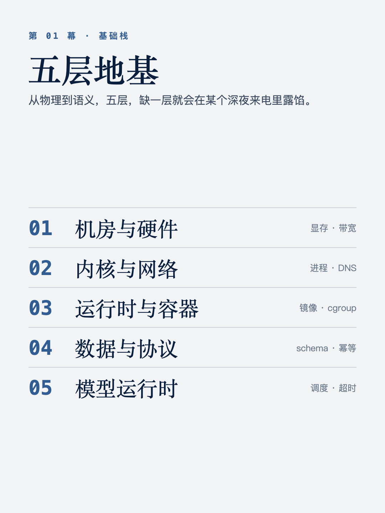

## 06 · 机房与内核：最不像 AI 的地方

显存带宽决定模型能不能跑；进程、socket、DNS 决定它跑起来之后为什么会坏。

AI 可以给你讲清楚 OOM 的原理，但它不知道你这台机器 cgroup 的限额、水位和回收策略。它能背出 DNS 解析的完整链路，却定位不了你集群里那条写错的 resolv.conf。

**越往下，越没有标准答案可以检索；越往下，越只能靠你自己在现场。** 这两层的价值不在知识量，在可观测。

## 07 · 容器不是打包

第 03 层，环境成为可交付物。

镜像是一份声明式承诺：同样的输入，在任何机器上给出同样的输出。

AI 三分钟能写出一份 Dockerfile，但不会替你判断：base image 里藏了多少未修的漏洞，数据卷的持久化边界在哪，cgroup 限额会不会在流量高峰把进程杀掉。

容器真正的产出不是「跑起来了」，是「换一个人、换一台机器，也一样跑起来」。

## 08 · 会写 ≠ 会验收

手写一遍的价值没有消失，它转移了位置。

不亲手写的人：报错就换一版，不问为什么；不知道瓶颈在 I/O 还是 CPU；上线后不敢改，因为看不懂；出了问题，只能再问一次 AI。

亲手写过的人：读得懂日志，能定位到哪一层；知道这个方案在我这台机器上跑不动；敢重构，因为知道边界在哪；能把问题描述成 AI 能接住的样子。

**以前手写是为了「产出」，现在手写是为了「标准」。** 你搭过的东西，才构成你验收别人的资格。

## 09 · 你没亲手搭过的东西，就没有资格验收

这句话听起来像道德要求，其实是能力边界。

验收不是点头，是能说出「这里会坏、坏在哪一层、怎么证明」。说不出这三句，点头就是赌。

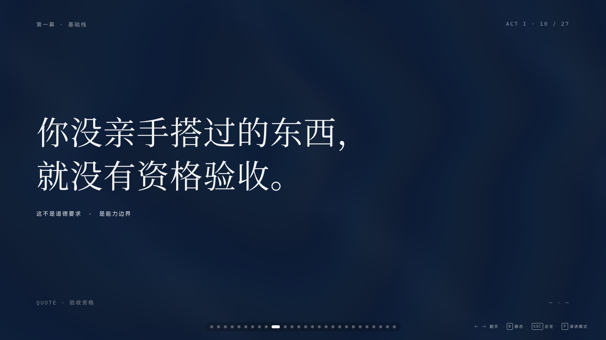

## 10 · 顺序比答案重要

一次真实的 502，从现象到根因，五步：看现象、看日志、看网络、看资源、看代码。

这五步正好是五层地基从上往下的倒序。**你脑子里的栈，就是你的排查路径。**

502 不是「服务挂了」，是「网关等不到响应」——先把这个症状说准，后面的判断才不会飘。谁在几秒之后放弃了等待？超时值写在谁身上？DNS、连接建立、TLS 握手三段分别排除，不要一起怀疑。然后才是 cgroup 限额、连接池、文件句柄——99% 的「偶发」都在这。最后才怀疑业务逻辑。

顺序错了，你会花三小时读一个没问题的函数。

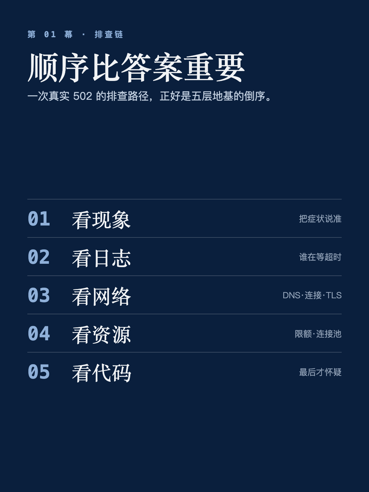

## 11 · 可信输入最贵

第 04 层：数据与协议。

模型的上限由数据决定，工程的上限由协议契约决定。

schema 决定 AI 生成的字段能不能落库；幂等决定重试会不会写两遍；鉴权决定「能调」和「该调」的区别。这三件事 AI 都能写，但只有你能签字。

AI 让生成变便宜，于是判断变贵。大部分团队的问题不是缺模型，是缺一份可信的输入。

## 12 · 它是新的 CPU

第 05 层，用旧知识理解新系统。

调度、隔离、缓存、权限、超时——模型运行时的行为，几乎可以和你已有的操作系统知识一对一迁移过来。

把它当魔法，你就只能祈祷；把它当运行时，你就会去查它的内存有多大、权限有多宽、超时怎么设、出错怎么兜。

凡是能用这五个词解释的现象，都不需要玄学。

## 13 · 如果每一层都能被写，你剩下的是什么

这是上半场的转折。

五层地基的每一层，AI 都能替你写一部分。那么剩下的是什么？

剩下的不是知识量，是结构。同样的模型，不同的人问，差的是问题的形状。

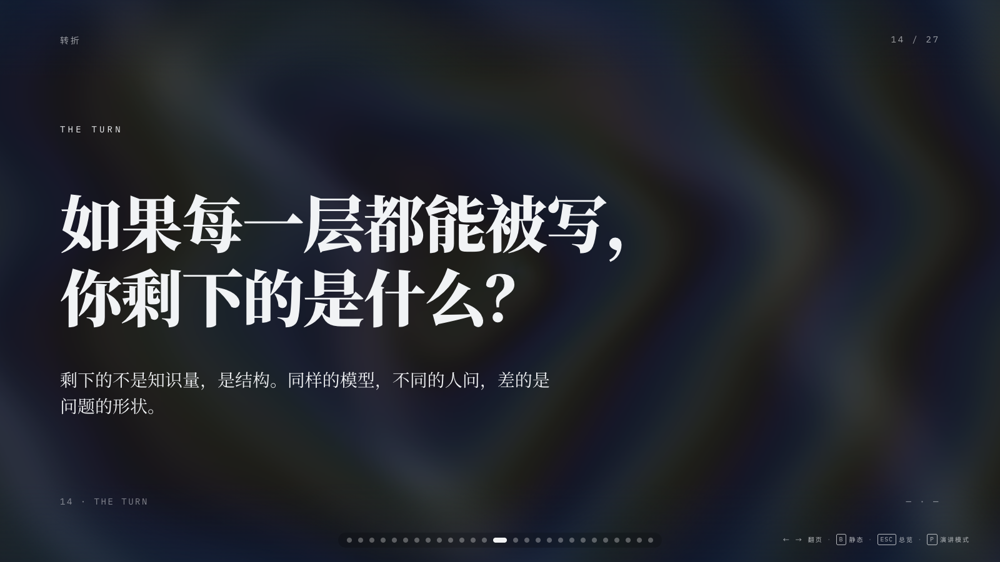

## 14 · 第二幕：本质栈

四种思维模型：金字塔、MECE、STAR、BSC。

它们不是沟通技巧，是你在 AI 面前唯一无法外包的部分。

## 15 · 能被检索的，都会被追上

两种栈，两种命运。

公共栈：可检索、可复制、可租用；更新速度快过你的学习速度；AI 掌握得比你更全；边际价值在下降，但不会归零。

私有栈：不可转让、不可下载；不会过时，只会变锋利；AI 只能放大它，不能替代它；边际价值随 AI 变强而上升。

**公共栈决定你能走多稳，私有栈决定你能走多远。** AI 把公共栈的价格打了下来，于是差价全都记在了私有栈上。

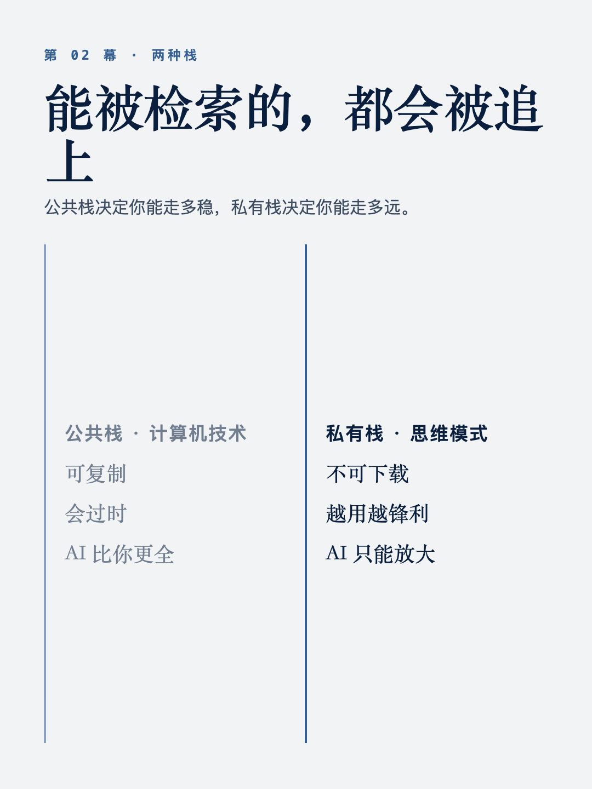

## 16 · 四个模型

四种模型，本质是四种提问方式：把你脑子里的东西，变成 AI 能接住的形状。

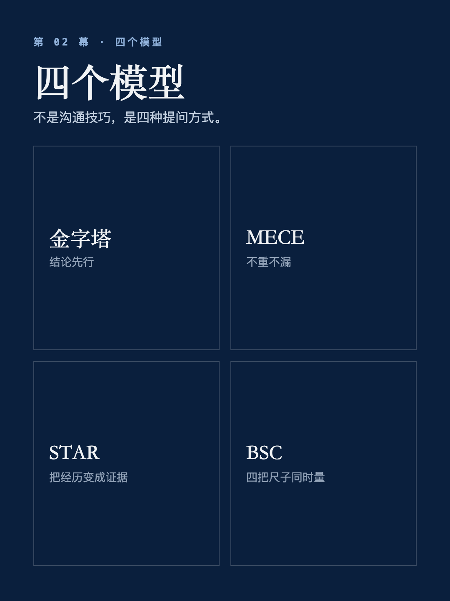

## 17 · 金字塔原理：结论先行

先给结论，再给三条支撑，每条支撑下面才是事实。人的注意力只够听第一句。

对 AI 的用法：第一句写下结论与验收标准，再让它填内容。

顺序反了，它会给你一篇正确的废话。

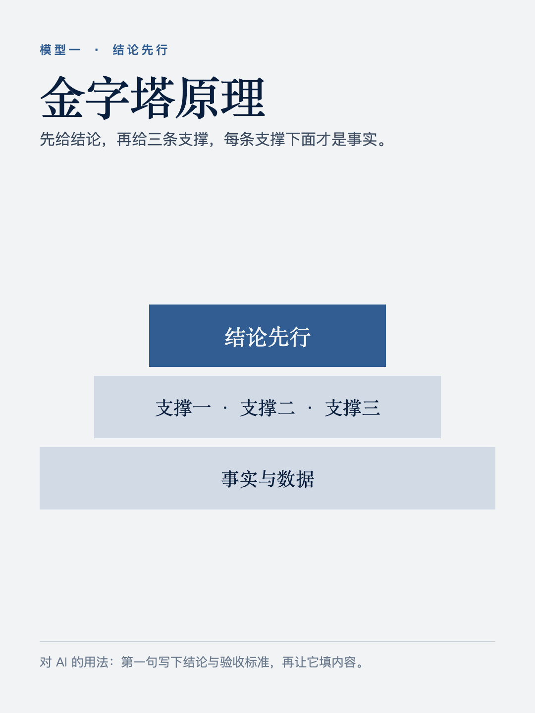

## 18 · MECE：不重不漏

相互独立（不重叠）、完全穷尽（不漏项）。判断一个拆解好不好，只看这两条。

它最有用的场景不是写咨询报告，而是写提示词：把一句模糊的需求，拆成几个互不重叠、加起来够用的维度，AI 才有地方落脚。

拆不对有两个信号：两个格子说的是同一件事；或者有一件事，哪个格子都放不下。

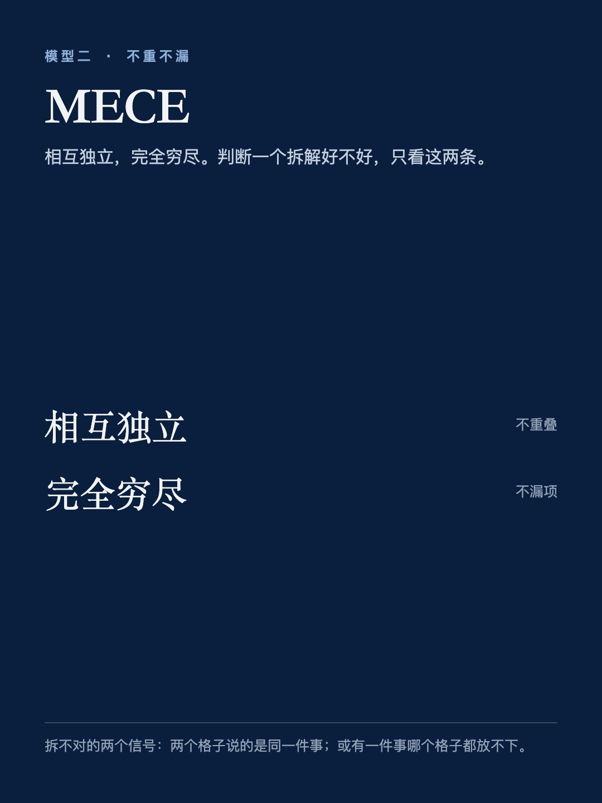

## 19 · 差距在问题里

同一个模型，两次提问，产出差一个量级。

模糊的问法：「帮我写一个数据同步方案。」

结构化的问法：结论先行（我要的是可回滚的增量同步）＋ 约束切分（数据量、延迟、失败重试、一致性要求分四条说清）＋ 验收标准（断点续传能验证、重复执行不写两遍）。

模型没变，变的只是你有没有先想清楚。结论先行来自金字塔，约束切分来自 MECE，可回滚来自你自己的基础栈。

## 20 · AI 不缺口才，缺的是你的问题

同一个模型，两种提问，一个量级的差距。

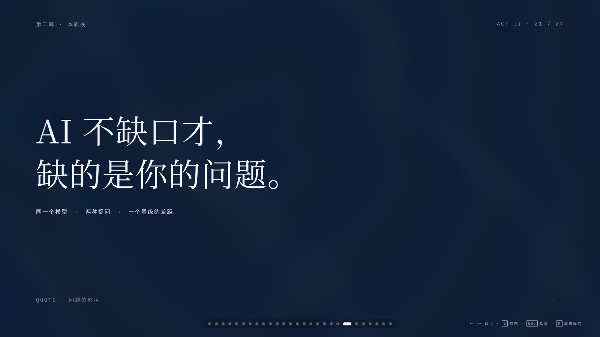

## 21 · STAR：把经历变成证据

情境、任务、行动、结果。它不是面试话术，是让别人——包括模型——理解你的最小结构。

你只给「行动」，AI 只能给你套路建议；你给出「情境」和「任务」，它才知道你在什么约束里做选择，建议才有针对性。

面试、周报、复盘、给 AI 描述背景，四个场景，同一副骨架。

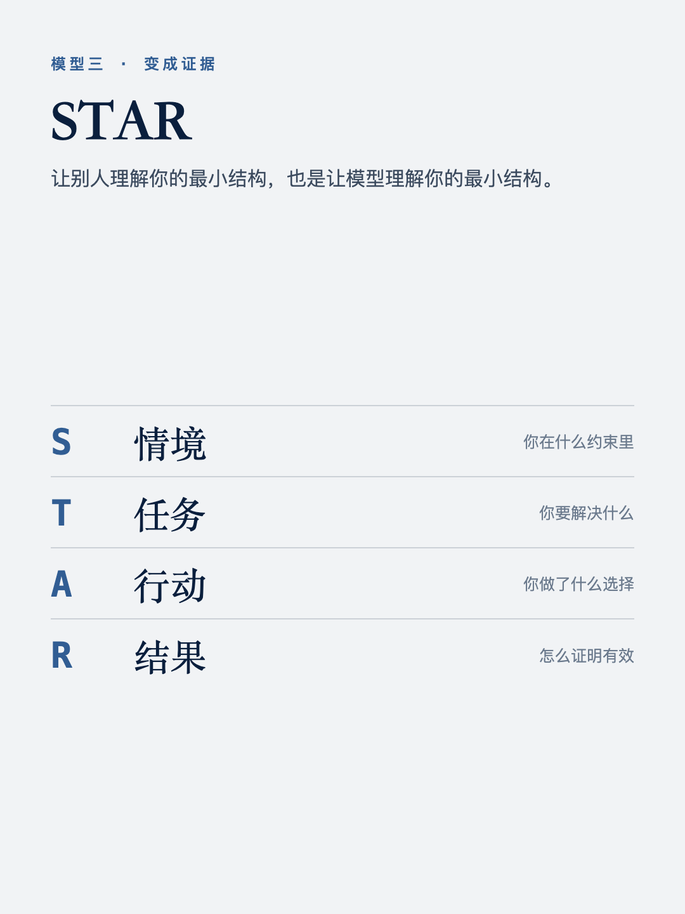

## 22 · BSC 个人版：四把尺子同时量

平衡计分卡本来用于组织，用在个人身上同样成立：只要一把尺子，你一定会把它刷到满分，然后原地不动。

财务（能力变现）、客户（对外交付）、流程（做事方式）、学习（增量），四个维度各打一分。

「今年我要学好 AI」不是目标，是愿望。把它写成四个可打分的格子，才叫计划。建议周期：每季度填一次，每周只看「学习增量」那一格。

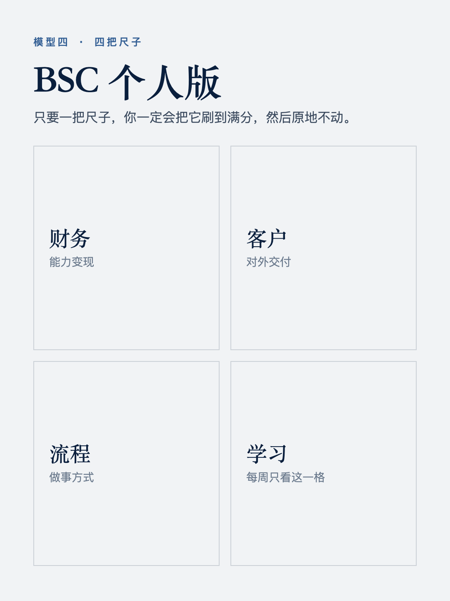

## 23 · 一条链：不是四个工具，是一条流水线

MECE 拆 → 金字塔排 → STAR 记 → BSC 量。

先拆开，再排好，再记下来，最后用四把尺子量一次。顺序颠倒，每一步都会失效。

这一步做完，你就把「让 AI 帮我写点什么」变成了「让 AI 在一个已经被我定义好的框架里填充」。前者是求运气，后者是求工程。

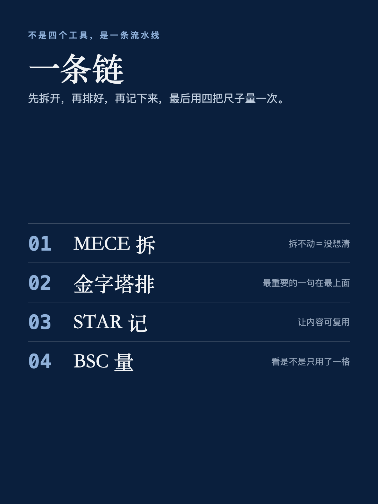

## 24 · 三个动作：从今天到本周五

不要一次全上，只做三件：

**拆一次**——把手上最模糊的那个需求，用 MECE 拆成四格，看看哪一格你答不上来。

**先写结论**——下次问 AI 之前，第一句话先写结论和验收标准。

**填一次 BSC**——四个维度各打一分，看看你是不是只在其中一格使劲。

先做第二条。它是唯一一条今天下班前就能完成、而且立刻见效的。

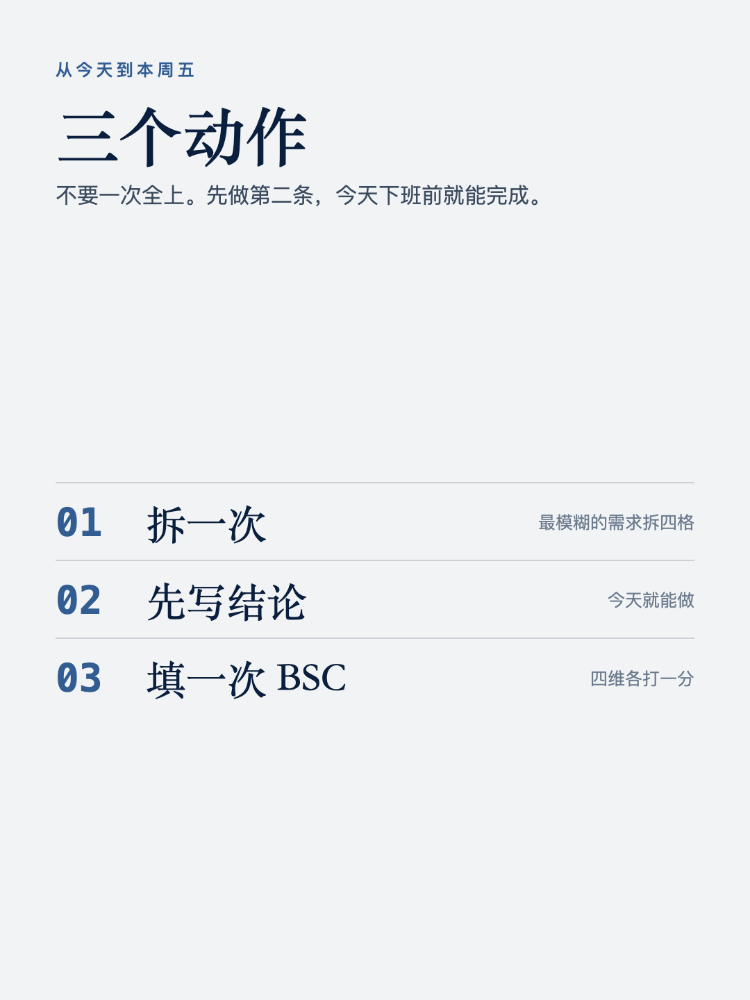

## 25 · 最后一个问题

分水岭不在你会不会用工具，在你能不能定义一个好问题。

栈越厚，问题越好。问题越好，模型越像专家；问题越差，模型越像客服。

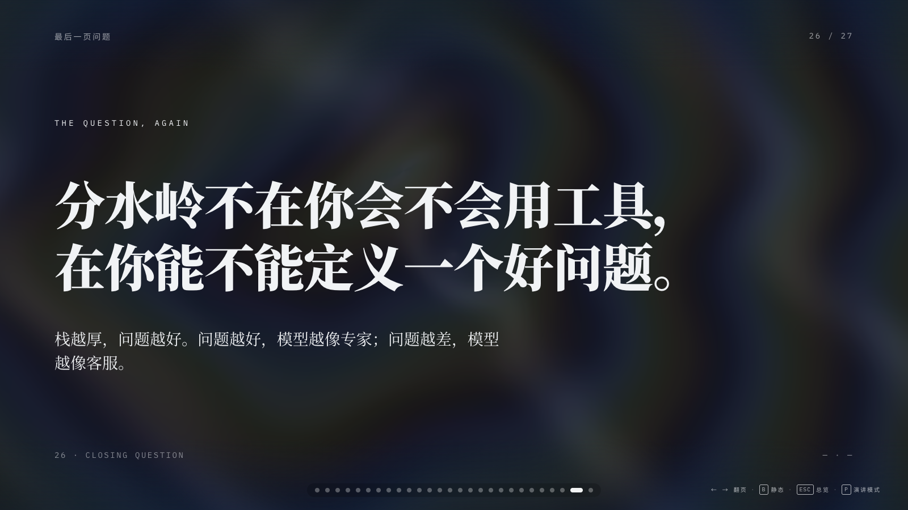

## 26 · 三句话带走

一、AI 折叠了「怎么做」，没有折叠「做到什么程度算对」。

二、公共栈决定你走多稳，私有栈决定你走多远，差价全记在私有栈上。

三、先写结论，再让 AI 填内容。顺序就是一切。

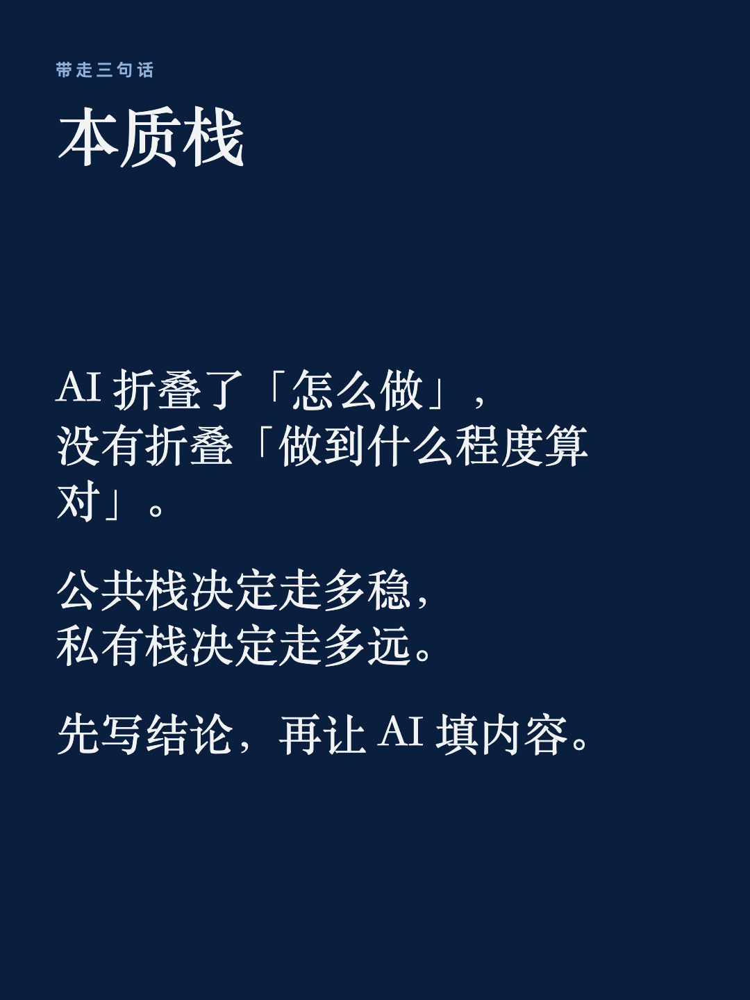

---

*本文整理自一场 60 分钟的分享《AI 时代计算机技术知识基础栈》。如果只带走一句：把「让 AI 帮我写点什么」，换成「让 AI 在我已经定义好的框架里填充」。*
