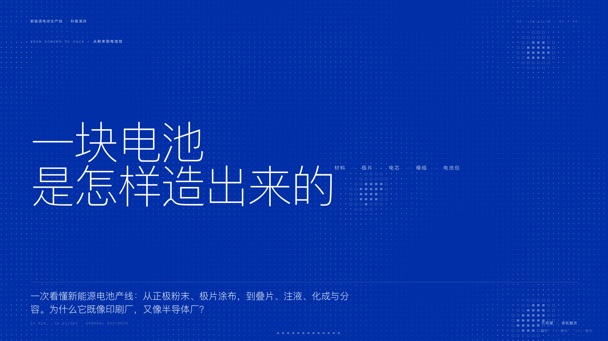

# 一块电池是怎样造出来的：新能源电池生产线科普

14 页科普演讲，面向关注新能源电池生产的普通听众。用 20 分钟回答五个问题：电池产线在造什么、六步主流程怎么走、哪几道工序最关键、卷绕和叠片怎么选、为什么良率才是产线真正的产品。

**调研快照**：2026-11-15（CST）  
**风格**：瑞士国际主义 · 克莱因蓝 IKB  
**用途**：科普分享；不构成投资建议。

## 文件

| 格式 | 页数 | 文件 |
|---|---:|---|
| 网页版（可翻页 / 可演示） | 14 | [index.html](index.html) |
| 可编辑 PPTX | 14 | [新能源电池生产线科普.pptx](新能源电池生产线科普.pptx) |
| 分享 PDF | 14 | [新能源电池生产线科普.pdf](新能源电池生产线科普.pdf) |
| 封面 | — | [cover.png](cover.png) |
| 演讲者提纲 | — | [speaker-notes.md](speaker-notes.md) |
| 调研与口径笔记 | — | [research-notes.md](research-notes.md) |

> 网页版需要和 `assets/motion.min.js` 一起使用；直接双击 `index.html` 即可播放。键盘 ← → 翻页，ESC 打开索引，B 切换静态模式。

## 结构

| 页码 | 内容 | 版式 |
|---|---|---|
| 1 | 封面：一块电池是怎样造出来的 | S01 |
| 2 | 三个背景数字：1.2 TWh / $108/kWh / 70 cells/s | S18 |
| 3 | 核心判断：把粉末变成能量的秩序 | S03 |
| 4 | 六步主流程：制浆→涂布→辊压→叠片/卷绕→封装→化成 | S11 |
| 5 | 三层结构：材料层 / 电芯层 / 系统层 | S17 |
| 6 | 三段战场：前段做均匀、中段做精准、后段做激活 | S13 |
| 7 | 四个关键工序：涂布 / 辊压 / 叠片卷绕 / 化成 | S19 |
| 8 | 卷绕 vs 叠片 | S08 |
| 9 | 成本拆解：材料约 82.9% | S07 |
| 10 | 质量宣言：良率才是产线真正的产品 | S12 |
| 11 | 质量闭环：检测→回流→调整→确认 | S14 |
| 12 | 十二道质量关口 + 70 cells/s | S15 |
| 13 | 下一站：让每一颗电芯都长得一样 | S09 |
| 14 | 三件事收尾：材料 / 工艺 / 数据 | S10 |

## 主要来源

1. IEA, *Global EV Outlook 2026 — Electric vehicle batteries*  
   https://www.iea.org/reports/global-ev-outlook-2026/electric-vehicle-batteries
2. BloombergNEF, *Lithium-Ion Battery Pack Prices Fall to $108 Per Kilowatt-Hour*（2025-12-09）  
   https://about.bnef.com/insights/clean-transport/lithium-ion-battery-pack-prices-fall-to-108-per-kilowatt-hour-despite-rising-metal-prices-bloombergnef/
3. Attia et al., *Challenges and opportunities for high-quality battery production at scale*, Nature Communications 16, 611 (2025)  
   https://pmc.ncbi.nlm.nih.gov/articles/PMC11725600/
4. Duffner et al., *Cost modeling for the GWh-scale production of modern lithium-ion battery cells*, Communications Engineering 3, 155 (2024)  
   https://www.nature.com/articles/s44172-024-00306-0
5. Roland Berger / RWTH PEM, *Battery Monitor 2022: Battery production and Product performance*  
   https://www.rolandberger.com/en/Insights/Publications/Battery-Monitor-2022-Battery-production-and-Product-performance.html
6. 安永《锂电池制程 10 大技术趋势》  
   https://www.ey.com/content/dam/ey-unified-site/ey-com/zh-cn/insights/strategy/documents/ey-10-technical-trends-of-lithium-ion-battery-industry-zh.pdf

## 口径提醒

- “70 cells/s” 是 38 GWh/年圆柱电芯工厂的产能换算量级，不代表所有产线。
- “30% → 5–10%” 是新线爬坡与成熟产线的行业观察区间，不代表某一家企业。
- 成本结构来自特定假设下的公开满成本模型，不含材料回收，不能直接当作当前市场报价。
