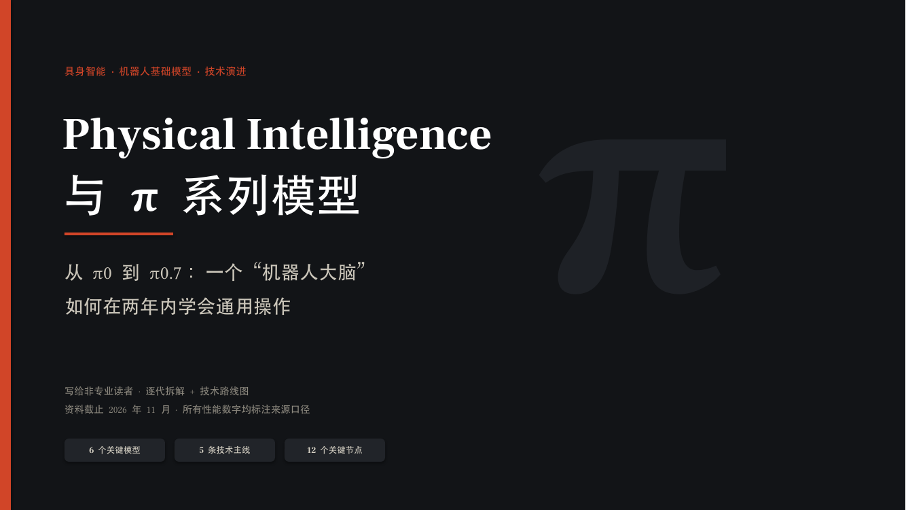

# Physical Intelligence 与 π 系列模型技术演进

一份面向非专业读者的 60 页讲解：从 π0 到 π0.7，逐代拆解架构、数据、训练目标与真实战绩，并给出完整技术路线图。

- **PPTX（可编辑）**：[Physical-Intelligence与pi系列模型技术演进.pptx](Physical-Intelligence与pi系列模型技术演进.pptx)
- **PDF（分享）**：[Physical-Intelligence与pi系列模型技术演进.pdf](Physical-Intelligence与pi系列模型技术演进.pdf)
- **生成日期**：2026-11-14
- **资料截止**：2026 年 11 月

## 结构

| 部分 | 页码 | 内容 |
|---|---|---|
| 开场 | 1–4 | 封面、阅读指南、一页看懂五个台阶、目录 |
| 01 为什么需要机器人大脑 | 5–10 | 传统机器人 vs 基础模型、VLA、难点、PI 是谁、公司时间线 |
| 02 π 家族总览 | 11–14 | 11 个名字一次分清、四阶段路线图、四代四问 |
| 03 逐代精讲 | 15–40 | π0 → π0-FAST → Hi Robot → π0.5 → KI → RTC → π0.6 → RECAP → π*0.6 → 人类数据 → 伙伴现场 → RL Token → π0.7 → 对比大表 → 因果链 |
| 04 五条技术主线 | 41–47 | 架构、动作表示、数据飞轮、模仿到强化、推理速度、评测 |
| 05 生态与商业 | 48–51 | 横向对比、开源版图、Pi API |
| 06 局限与未来 | 52–60 | 五个短板、四个争议、未来看点、小白八问、十句总结、术语表、来源 |

## 主要来源

- π0, arXiv:2410.24164（2024.10）
- FAST, arXiv:2501.09747（2025.01）
- Hi Robot, arXiv:2502.19417（2025.02）
- π0.5, arXiv:2504.16054（2025.04）
- Knowledge Insulation, arXiv:2505.23705（2025.05）
- RTC, arXiv:2506.07339（2025.06）
- π*0.6 / RECAP, arXiv:2511.14759（2025.11）
- RL Token, arXiv:2604.23073（2026.03）
- π0.7, arXiv:2604.15483（2026.04）
- PI 官方博客：Open Sourcing π0、The Physical Intelligence Layer、Pi API beta

## 注意

- 文中性能数字多为 PI 自评，尚无第三方独立复现；已在对应页面标注口径。
- 融资与估值信息来自彭博社、The Robot Report、TechCrunch 等报道，截至 2026-11 部分仍为洽谈状态。
- 字体指定 PingFang SC（macOS 原生）；Windows 打开会自动替换中文字体，版式可能略有位移。
