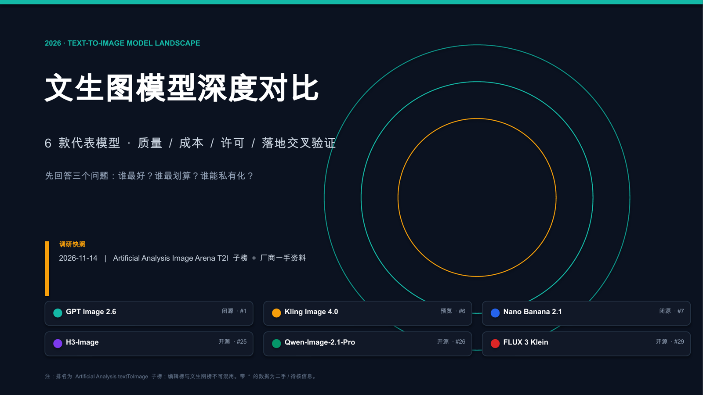

# 2026 文生图模型深度对比

17 页文生图模型选型报告，覆盖 6 款代表模型：GPT Image 2.6 Sunburst、Kling Image 4.0 preview、Nano Banana 2.1、MiniMax H3-Image、Qwen-Image-2.1-Pro、FLUX 3 Image Klein。每页含数据、图表/矩阵与结论，并附演讲备注。

**调研快照**：2026-11-14（CST）  
**质量口径**：Artificial Analysis Image Arena 的 `textToImage` 子榜（人类两两盲选偏好 Elo）  
**落地口径**：厂商模型卡 / 官方博客 / GitHub README / ModelScope / 许可文本

## 文件

| 格式 | 页数 | 文件 |
|---|---:|---|
| 可编辑 PPTX | 17 | [文生图模型深度对比.pptx](文生图模型深度对比.pptx) |
| 分享 PDF | 17 | [文生图模型深度对比.pdf](文生图模型深度对比.pdf) |
| 调研与交叉验证笔记 | — | [research-notes.md](research-notes.md) |

## 结构

| 页码 | 内容 |
|---|---|
| 1 | 封面 |
| 2 | 执行摘要：质量、成本、可控性正在分叉 |
| 3 | 调研方法：质量层 / 能力层 / 落地层与证据分级 |
| 4 | 市场全景：总榜 Top 12 + 开源子榜 |
| 5 | 六模型总览 |
| 6 | GPT Image 2.6 Sunburst 深度页 |
| 7 | Kling Image 4.0 preview 深度页 |
| 8 | Nano Banana 2.1 深度页 |
| 9 | MiniMax H3-Image 深度页 |
| 10 | Qwen-Image-2.1-Pro 深度页 |
| 11 | FLUX 3 Image Klein 深度页 |
| 12 | 六模型横向对比矩阵 |
| 13 | 质量–成本前沿与边际成本 |
| 14 | 场景选型决策表 |
| 15 | 成本 / TCO 测算 |
| 16 | 风险清单与 4 步 POC |
| 17 | 证据等级、待核清单与来源 |

## 核心数据

| 模型 | 类型 | T2I Elo | 全榜排名 | 参考价（USD/1k 张） | 一句话判断 |
|---|---|---:|---:|---:|---|
| GPT Image 2.6 Sunburst | 闭源 | **1260.7** | #1 | $210.7 | 质量天花板，适合高价值低量商稿 |
| Kling Image 4.0 preview | 闭源预览 | **1179.9** | #6 | 未公开 | 影视审美黑马，但仍需 POC |
| Nano Banana 2.1 | 闭源 | **1176.1** | #7 | $33.6 | 综合最均衡，建议默认主力 |
| MiniMax H3-Image | 开源权重 | **1065.7** | #25 | $21.8 | 4K<10s，开源质量王但部署重 |
| Qwen-Image-2.1-Pro | 开源权重 | **1058.2** | #26 | $35.3 | 中文、透明素材、统一编辑 |
| FLUX 3 Image Klein | 开源权重 | **1041.3** | #29 | $9.0 | 成本杀手，本地部署首选 |

## 交叉验证要点

- **严格区分 AA 的 `textToImage` 与 `imageEditing` 两套 Elo**。同一模型在两榜分数不同，混用会显著改变排名。
- **Nano Banana 2.1**：Google DeepMind 模型卡确认 4K、1M 输入、信息图 Elo 1048、编辑 Elo 1026；与 AA 方向一致。
- **H3-Image**：官方博客 + GitHub README 确认 33.1B DiT、4K<10s、最多 16 张参考图、Community License；AA Elo 为单源。
- **Qwen-Image-2.1-Pro**：官方 README / ModelScope 确认 7B、原生 RGBA、最多 10 张参考图；许可为 Qwen Research License。
- **FLUX 3 Klein**：BFL 官方称内部评测“开源第一”，但 AA 大众偏好仅 #29；两者方向冲突，已在报告中标注。
- **GPT Image 2.6**：OpenAI 官网在本环境返回 403，发布日期与部分规格来自二手报道，标记为 B 级。
- **Kling Image 4.0**：AA 给出 #6，但可灵开放平台仍以 Image 3.0 / 3.0 Omni 为主，4.0 价格/SLA/规格未公开，标记为 C 级。

## 主要来源

- Artificial Analysis — Image Arena / Text to Image：<https://artificialanalysis.ai/text-to-image>
- Google DeepMind — Nano Banana 2.1 Model Card（2026-10-06）：<https://deepmind.google/models/model-cards/nano-banana-2-1/>
- MiniMax — H3-Image 官方博客（2026-11-11）：<https://www.minimax.io/blog/minimax-h3-image>
- MiniMax — GitHub README：<https://github.com/MiniMax-AI/MiniMax-H3-Image>
- Qwen — Qwen-Image-2.1 README：<https://github.com/QwenLM/Qwen-Image-2.1>
- Qwen — ModelScope：<https://modelscope.cn/models/Qwen/Qwen-Image-2.1>
- Black Forest Labs — FLUX 3 Image Klein（2026-10-15）：<https://bfl.ai/blog/flux-3-image-klein>
- Kling 开放平台：<https://app.klingai.com/global/dev/document-api>

## 口径与限制

- Elo 是“人类更喜欢哪张”的偏好度量，不直接等于文字准确率、计数、空间关系正确率。
- 95% 置信区间约 ±12–14；部分名次差距在统计上不显著。
- 价格为 AA 代表性 API 口径，不是厂商账单；实际成本随分辨率、档位、批量折扣变化。
- 开源模型的自托管成本未计入 GPU 折旧、电费、运维与合规。
- 厂商内部 benchmark 与第三方大众偏好可能冲突，上线前应以业务 prompt 盲测为准。

---

生成日期：2026-11-14
