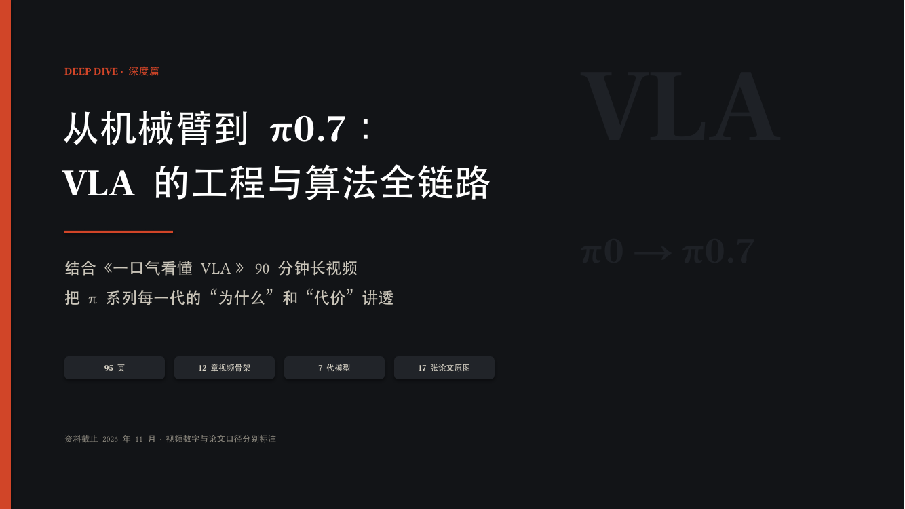

# VLA 与 π 系列模型深度解析（图文版 + 演讲版）

- **深度版（阅读/查阅）**：106 页，17 张论文原图、8 个章节分隔页、每页演讲备注、数字口径表。
- **演讲版（30 分钟）**：30 页，每页一个结论 + 一张图，适合直接上台。

叙事骨架结合 B 站 90 分钟长视频《一口气看懂 VLA》（UP：可lip），并补充论文与工程细节。

## 文件

| 版本 | 页数 | PPTX | PDF |
|---|---|---|---|
| 深度版 | 106 | [VLA与pi系列模型深度解析.pptx](VLA与pi系列模型深度解析.pptx) | [.pdf](VLA与pi系列模型深度解析.pdf) |
| 演讲版 | 30 | [VLA与pi系列模型演讲版.pptx](VLA与pi系列模型演讲版.pptx) | [.pdf](VLA与pi系列模型演讲版.pdf) |

## 深度版结构

| 部分 | 页码 | 内容 |
|---|---|---|
| 导读 | 1–4 | 两版差异、全书结构（带页码）、VLA 闭环总图 |
| P1 硬件与动作 | 5–11 | 机械臂、关节/末端、50Hz、episode、训练样本、六个工程坑 |
| P2 前史 | 12–20 | RT-2、OpenVLA（含原图）、三个共同瓶颈 |
| P3 π0 | 21–35 | 数据、双专家、多峰、flow matching、掩码、chunk/KV、原图 |
| P4 π0.5 | 36–51 | FAST、Hi Robot、五类数据、两阶段、注意力隔离、VI 数据、真实家庭 |
| P5 π0.6 | 52–67 | 两道天花板、RL 四概念、RECAP、奖励/价值/优势、六步循环、原图 |
| P6 π0.7 | 68–92 | MEM、组合泛化、元数据、控制模式、世界模型、dropout、成本、原图 |
| P7 判断 | 93–100 | 四代对照、四条路线、开源版图、评测、三个隐含假设、学习路径 |
| 附录 | 101–106 | 十二句总结、数字口径表、术语表、来源、结语 |

新增的三页：**P91 四种典型失败**、**P94 四条路线对比**、**P103 数字口径表**。

## 论文原图清单（深度版）

| 页 | 图 | 来源 |
|---|---|---|
| 14 | RT-2 总览 | RT-2, arXiv:2307.15818, Fig. 1 |
| 17 | OpenVLA 架构 | OpenVLA, arXiv:2406.09246, Fig. 2 |
| 24 | π0 框架总览 | π0, arXiv:2410.24164, Fig. 3 |
| 26 | π0 数据混合 | π0, arXiv:2410.24164, Fig. 4 |
| 38 | FAST 分词 | FAST, arXiv:2501.09747, Fig. 1 |
| 40 | Hi Robot 分层 | Hi Robot, arXiv:2502.19417, Fig. 2 |
| 43 | π0.5 两阶段 | π0.5, arXiv:2504.16054, Fig. 3 |
| 46 | π0.5 注意力掩码 | π0.5, arXiv:2504.16054, Fig. 18 |
| 50 | π0.5 真实家庭结果 | π0.5, arXiv:2504.16054, Fig. 7(b) |
| 57 | RECAP 交互 | π*0.6, arXiv:2511.14759, Fig. 3 |
| 60 | 价值函数可视化 | π*0.6, arXiv:2511.14759, Fig. 4 |
| 66 | RECAP 任务 | π*0.6, arXiv:2511.14759, Fig. 2 |
| 70 | π0.7 灵巧任务 | π0.7, arXiv:2604.15483, Fig. 6 |
| 72 | MEM 结构 | MEM, arXiv:2603.03596, Fig. 1 |
| 76 | π0.7 prompt | π0.7, arXiv:2604.15483, Fig. 3 |
| 88 | 跨本体新策略 | π0.7, arXiv:2604.15483, Fig. 13 |
| 90 | 14 个家庭评测 | π0.7, arXiv:2604.15483, Fig. 9 |

图片按 arXiv 原图重新下载（最长边 2400px），JPEG q=92；版权归原作者，引用请遵循 arXiv 许可。

## 来源

- 视频：可 lip《一口气看懂 VLA：从机械臂关节到 π0.7》，B 站 BV17YHY6LEPN
- 文字整理：ChenAI-TGF，cnblogs.com/ChenAI-TGF/p/23276798
- 论文：RT-2 (2307.15818)、OpenVLA (2406.09246)、π0 (2410.24164)、FAST (2501.09747)、Hi Robot (2502.19417)、π0.5 (2504.16054)、KI (2505.23705)、RTC (2506.07339)、π*0.6 (2511.14759)、MEM (2603.03596)、π0.7 (2604.15483)、RL Token (2604.23073)
- 工程笔记：fengzichao.github.io、6chhenry.github.io

## 口径说明

- 深度版每页都有演讲备注；标注“视频整理稿”的数字（5 张 H100、127ms、201 个价值桶、28%/54%/87%）来自第三方整理，未逐条核对论文。
- π0 动作专家参数量按论文取 300M；性能数字多为 PI 自评。
- 数字口径集中在深度版第 103 页。
